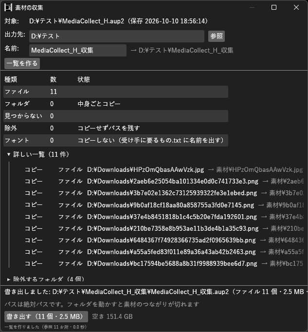

# MediaCollect_H マニュアル



**MediaCollect_H（素材の収集）** は、保存したプロジェクトが使っている素材のファイルを 1 つのフォルダに集め、
パスを集めた先に書き換えた**別名のプロジェクト**を書き出す汎用プラグインです。
作品を外付けドライブや別のPCへ移すとき、人に渡すとき、完成後にまとめて保管するときに使います。
**元のプロジェクトと素材に書き込むことはありません。** 書くのは、新しく作る書き出し先のフォルダの中だけです。

- **バージョン:** 0.1.0
- **作者:** by HexBrowns
- **必要環境:** AviUtl2 **2.1.11** 以上

---

## 開き方

- **表示** メニュー → **素材の収集**

## 導入

1. `Plugin\MediaCollect_H\MediaCollect_H.aux2` を配置する。
2. AviUtl2を起動する。
3. **表示** メニュー → **素材の収集** でウィンドウを開く。

---

## 使い方

1. 集めたいプロジェクトを開き、**保存しておく**。保存していない変更は入らない。
2. **出力先** を決める。**参照** でフォルダを選べる。**名前** は最初は `<プロジェクト名>_収集`。
   どちらの欄も、Enterかほかをクリックで確定し、入力中のEscで入力前に戻る。
3. **一覧を作る** を押す。プロジェクトが使っているファイルを数えます。
4. 数と **詳しい一覧** を見て、**書き出す（○ 個・○ GB）** を押す。
5. 終わったら **フォルダを開く** で中身を見る。書き出した `.aup2` をAviUtl2で開けば、集めた素材で動きます。

書き出しの途中で **中止** を押せます。
それまでにコピーし終えたファイルは書き出し先に残ります。
書きかけのファイルは消し、プロジェクトは書き出しません。

## 書き出すもの

```
<出力先>\<名前>\
├── <名前>.aup2                     パスを書き換えたプロジェクト
├── <名前>.CurveEditor_H.Live.lua   CurveEditor_H を使っていれば、その Live とライブラリ
├── 素材\                           使っているファイル（平らに置く）
├── 収集.json                        元のパスと置いた先の対応
└── 受け手に要るもの.txt              フォント・使っている効果など、受け手の AviUtl2 に入っている必要があるもの
```

- 素材は `素材\` に平らに置きます。同じ名前で元の場所が違うものは、`名前_1a2b3c4d.png` のように名前に印を付けます
- 同じファイルを何か所で使っていても、コピーは 1 回です
- フォルダを指す項目は、フォルダの中身ごとコピーします
- 図形の「図形の種類」などに指定したファイルも集めます
- 書き換えるのは素材のパスの行だけで、プロジェクトの他の部分は 1 文字も変えません

## 一覧の見方

| 種類 | 意味 |
|---|---|
| ファイル / フォルダ | コピーするもの |
| 推定 | 入っていない効果（スクリプト）の項目や、種類がファイルでない項目で、実在するファイルを指していたもの。念のため拾います |
| 読み替え | プロジェクトのフォルダを動かす前のパスのままのもの。AviUtl2と同じく、今のプロジェクトのフォルダの同じ所で見つけて拾います。動かす前のフォルダの中にあったものだけが対象です |
| 見つからない | 元の場所に無いファイル。パスは元のまま残し、書き出しは止めません |
| 除外 | 除外するフォルダの中にあるもの。コピーせず、パスをそのまま残します |
| 連番 | 連番の画像。指定のファイルだけを写し、他の番号は写しません |
| フォント | コピーしません。`受け手に要るもの.txt` に名前を出します |

- **詳しい一覧** は、見つからないものを先頭に出します
- つながっていないドライブや共有フォルダの素材は、ドライブ・共有フォルダごとに 1 回だけ確かめ、その中のものをまとめて「見つからない」にします

## 除外するフォルダ

この中にあるファイルはコピーせず、パスをそのまま残します。
既定は次の 4 つです。
**除外するフォルダ** で 1 行に 1 つずつ変えられ、**既定に戻す** で戻ります。

- AviUtl2のデータフォルダ `C:\ProgramData\aviutl2\`
- `C:\Windows\`
- `C:\Program Files\`、`C:\Program Files (x86)\`

出力先と除外するフォルダの設定は `Plugin\MediaCollect_H\settings.json` に残ります。

## 注意

- **書き出した `.aup2` のパスは絶対パスです。** 書き出したフォルダを別の場所へ動かすと、素材のつながりが切れます
- 次のものは集めません: フォント、スクリプト・プラグイン本体、スクリプトのコードの中で読むファイル、テキストの中に書いたパス
- 出力先に、中身のあるフォルダは選べません。元のプロジェクトのフォルダそのものや、コピーするフォルダの中も選べません
- 空きが足りないときは書き出せません。ボタンの下に空きと必要な大きさが出ます
